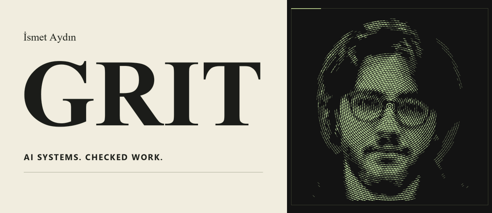

<picture>
  <source media="(prefers-reduced-motion: reduce)" srcset="assets/profile/grit-portrait-cover.png">
  
</picture>

[Static cover](assets/profile/grit-portrait-cover.png) · [View animation](assets/profile/grit-portrait-loop.gif)

# Grit · İsmet Aydın

**Open-source tools for coding agents · Ankara, Türkiye**

I build tools for keeping project memory, connecting agents, and checking what their work actually proves. Start with one small task and inspect the result.

[Website](https://okgrit.me/) · [X @okgrit](https://x.com/okgrit) · [Instagram @okgrit](https://www.instagram.com/okgrit/) · [Instagram @ismt.aydin](https://www.instagram.com/ismt.aydin/) · [Get in touch](https://okgrit.me/#iletisim)

**Start here:** [Try done-is-a-claim on your next small task](https://github.com/Grit-77/done-is-a-claim#get-started).

Follow this profile for coding-agent tools and concrete usage notes. You can also find me at [@okgrit](https://x.com/okgrit).

## Selected work

### [done-is-a-claim](https://github.com/Grit-77/done-is-a-claim)

**Your agent says “done”. What would prove it?**

Incident-backed rules and focused skills for coding agents, with local tools for capturing and rechecking evidence. Start with a Markdown rules file; add the workflows you need.

[Use it on one task](https://github.com/Grit-77/done-is-a-claim#get-started) · [Read the rules](https://github.com/Grit-77/done-is-a-claim/blob/main/AGENTS.md) · [Try the demo](https://github.com/Grit-77/done-is-a-claim#watch-a-false-green)

### [Remember, Dammit.](https://github.com/Grit-77/remember-dammit)

**I already told you.**

Shared local memory for AI agents, with source-linked records and correction history. Available as a source alpha; native-client integrations are still being validated.

[Try a first save and recall](https://github.com/Grit-77/remember-dammit#get-started) · [Client evidence and limits](https://github.com/Grit-77/remember-dammit/blob/main/docs/LIVE-ACCEPTANCE.md)

### [dotline](https://github.com/Grit-77/dotline)

**A small mailbox between your ChatGPT dot and Claude Code.**

Send a request, claim the work, and read the reply through ordinary HTTPS. Python standard library, with no model API calls. The coding session does the work; you decide what it may authorize.

[How it works](https://github.com/Grit-77/dotline#quickstart-three-steps) · [Trust and security](https://github.com/Grit-77/dotline#trust-and-security)

### [Give It a Plot.](https://github.com/Grit-77/give-it-a-plot)

**Parcel to Design · P2D**

Tools for turning parcel and zoning inputs into architectural plans, sheets, renders, and editable CAD files. Architect review required.

---

**Useful tools. Inspectable work.**

I also build websites and AI automations. Have a concrete problem to build around? [Let's talk](https://okgrit.me/#iletisim). Türkçe de yazabilirsiniz.
